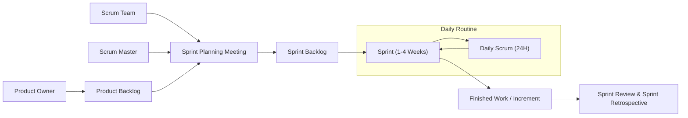
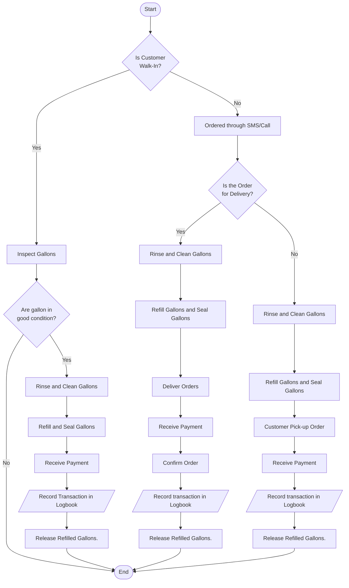
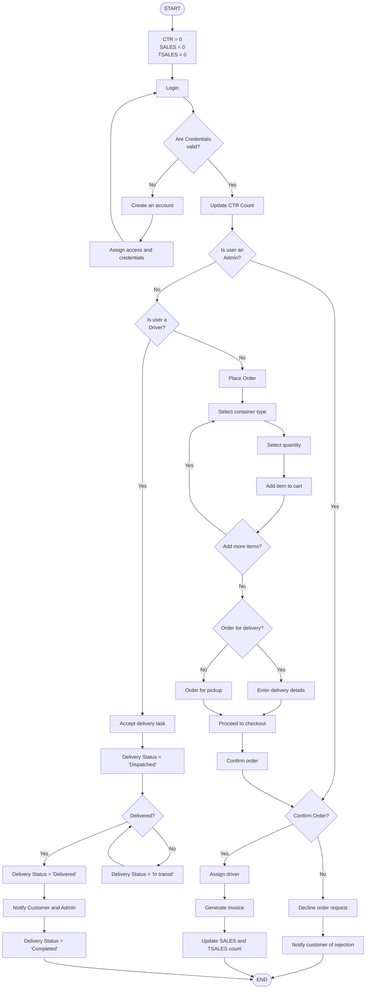
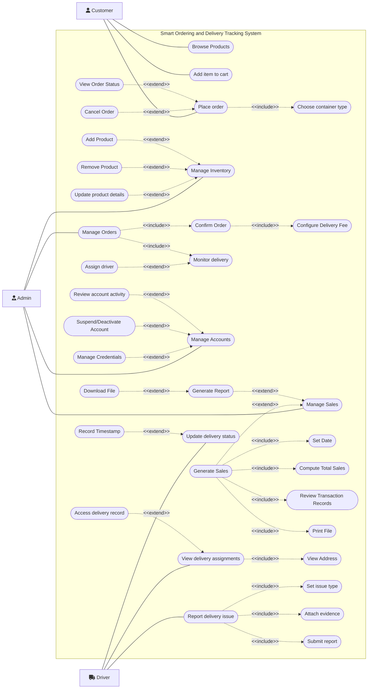
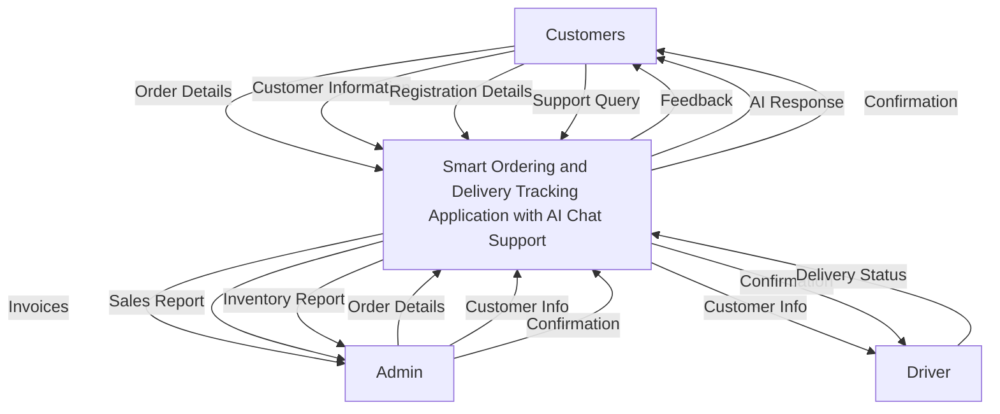

# SMART ORDERING AND DELIVERY TRACKING APPLICATION WITH AI CHAT SUPPORT FOR JJAASS WATER MARKET

**A Capstone Project Presented to the Faculty of Computer Studies Department**  
**Polytechnic Institute of Tabaco**  
**100 Panal, Tabaco City**

In Partial Fulfillment of the Requirements for the Degree Bachelor of Science in Information Technology

**Harold Criston V. Borbo**  
**Juliana Nicole B. Banico**  
**Kaycee T. Biescas**

**November 2025**

---

### POLYTECHNIC INSTITUTE OF TABACO
100 Panal, Tabaco City

#### RECOMMENDATION FOR PROPOSAL DEFENSE

This thesis titled **“SMART ORDERING AND DELIVERY TRACKING APPLICATION WITH AI CHAT SUPPORT FOR JJAASS WATER MARKET”** prepared by Juliana Nicole B. Banico, Harold Criston V. Borbo, and Kaycee T. Biescas, in partial fulfillment of the requirements for the degree of Bachelor of Science in Information Technology (BSIT) is hereby submitted to the Capstone Committee for appropriate action.

**MIKE JUSTINE O. BERTILLO**  
*Adviser*

---

### POLYTECHNIC INSTITUTE OF TABACO
100 Panal, Tabaco City

#### CERTIFICATION OF FINAL RATING

**Candidate:** Juliana Nicole B. Banico, Harold Criston V. Borbo, Kaycee T. Biescas  
**Thesis:** Smart Ordering and Delivery Tracking Application with AI Chat Support for JJAASS Water Market

| Panel of Oral Examiners | Grade | Action | Signature |
| :--- | :--- | :--- | :--- |
| **JAIME Ll. GUARDINO** | ________ | ________ | ________ |
| **MARILOU S. BENOZA-LANSANGAN** | ________ | ________ | ________ |
| **JP REMAR SERRANO** | ________ | ________ | ________ |

**Final Rating:** _________

---

### POLYTECHNIC INSTITUTE OF TABACO
100 Panal, Tabaco City

#### APPROVAL SHEET

This project study titled **“Smart Ordering and Delivery Tracking Application with AI Chat Support for JJAASS Water Market”**, was prepared and submitted by Juliana Nicole B. Banico, Harold Criston V. Borbo, and Kaycee T. Biescas, in partial fulfillment of the requirements for the degree in Bachelor of Science in Information Technology, has been examined and recommended for acceptance and approval for final defense.

**MIKE JUSTINE O. BERTILLO**  
*Adviser*

**Capstone Committee Members**

**JP REMAR A. SERRANO, MIS**  
*Panel Member*

**JAIME Ll. GUARDINO**  
*Panel Member*

**MARILOU B. LANSANGAN, MM, MIT, DIT**  
*Chairperson*

#### PANEL OF EXAMINERS

Approved by the Committee on Oral Examination _________________________ with the Grade of _________.

**MARILOU B. LANSANGAN, MM, MIT, DIT**  
*Chairperson*

**JP REMAR A. SERRANO, MIS**  
*Panel Member*

**JAIME Ll. GUARDINO**  
*Panel Member*

ACCEPTED AND APPROVED in partial fulfillment of the requirements for the degree, Bachelor of Science in Information Technology in Polytechnic Institute of Tabaco.

**TOM JUSTINE B. MILITANTE, MPM**  
*Capstone Project Coordinator*

**ELMER C. FIGURACION, MIT**  
*Dean, College of Computer Studies*

**JAIME Ll. GUARDINO**  
*President*

---

### POLYTECHNIC INSTITUTE OF TABACO
100 Panal, Tabaco City

#### CERTIFICATION OF EDITOR

This is to certify that the undergraduate thesis entitled **“Smart Ordering and Delivery Tracking Application with AI Chat Support for JJAASS Water Market”**, prepared and submitted by Juliana Nicole B. Banico, Harold Criston V. Borbo, and Kaycee T. Biescas for the undergraduate research in Information Technology has been edited by the undersigned.

______________________  
*Editor*

---

### POLYTECHNIC INSTITUTE OF TABACO
100 Panal, Tabaco City

#### ACCEPTANCE SHEET

This thesis titled **“Smart Ordering and Delivery Tracking Application with AI Chat Support for JJAASS Water Market”**, after having been recommended and approved, is hereby accepted by Polytechnic Institute of Tabaco.

**Mr. JAIME Ll. GUARDINO**  
*President*

---

### ACKNOWLEDGMENT

Authors’ Initial

---

### POLYTECHNIC INSTITUTE OF TABACO
100 Panal, Tabaco City

#### ABSTRACT

**Title:** SMART ORDERING AND DELIVERY TRACKING APPLICATION WITH AI CHAT SUPPORT FOR JJAASS WATER MARKET  
**Authors:** Juliana Nicole B. Banico, Harold Criston V. Borbo, Kaycee T. Biescas  
**Type of Document:** Project Study  
**Type of Publication:** Unpublished  
**Accrediting Institution:** Polytechnic Institute of Tabaco, 100 Panal, Tabaco City

---

### TABLE OF CONTENTS

#### PRELIMINARIES (PAGE)
- Title Page: i
- Recommendation for Final Defense: ii
- Certification of Final Rating: iii
- Approval Sheet: iv
- Acceptance Sheet: v
- Certification of Editor: vi
- Acknowledgement: vii
- Abstracts: viii
- Table of Contents: ix
- List of Figures: xii

#### INTRODUCTION
- Background of the Study: 1
- Company Profile: 11
- Importance of the Study: 12
- Statement of the Problem: 14
- Definition of Terms: 15

#### METHODS
- Software Development Methodology: 18
- Scope and Delimitation of the Study: 24
- Data Gathering Techniques: 25
- Sources of Data: 26
- Tools for Data Analysis: 27

#### REFERENCES: 36

---

### LIST OF FIGURES

| Figure | Title | Page |
| :---: | :--- | :---: |
| 1 | THE SCRUM PROCESS Scrum Methodology | 19 |
| 2 | Existing System Flowchart | 31 |
| 3 | Proposed System Flowchart | 32 |
| 4 | Use Case Diagram | 33 |
| 5 | Conceptual Design Diagram (Data Flow Diagram) | 34 |

---

# INTRODUCTION

### Background of the study

The increasing demand for clean and safe drinking water, coupled with growing environmental concerns, has driven the expansion of the water refill market globally. These stations serve as a vital source of affordable and purified water for many communities, particularly in urban areas and developing regions where access to water is limited.

One of the most essential resources for sustaining life is water. Natalie Silver (2023) claimed that water makes up a majority of individual body weight and is involved in many important functions. This includes flushing out waste from the body, regulating individual body temperature, and helping brain function. Water is important to nearly every part of the body. It also plays a crucial role in human survival. Similarly, according to GeeksforGeeks (2025), water is the fundamental need of individuals' daily lives. It helps people to perform basic functions of life. From drinking water to agriculture to cooking food, water is the most fundamental need of living beings.

In 2022, globally, at least 1.7 billion people use a drinking water source contaminated with feces. Microbial contamination of drinking water as a result of contamination with feces poses the greatest risk to drinking water safety (WHO, 2023). This shows how important clean and safe water is, since it is necessary for life and protecting people from waterborne diseases. Having access to safe drinking water is not only vital for good health but also for hygiene, sanitation, and the overall well-being of communities.

Water refills have become an important part of daily life, especially in urban and rural areas where tap water may not always meet safety standards. It has become special in recent years due to the increasing scarcity of available natural sources of water. According to WWF (2025), 1.1 billion people worldwide lack access to water, and a total of 2.7 billion find water scarce for at least one month of the year. Water refills also have become a vital source of safe, affordable drinking water for many communities. It's not only vital for daily consumption but also for industry, and commercial services worldwide, such as water refills that provide purified drinking water to households and communities.

The establishment of water refilling stations is one of the most accessible solutions to the need for clean and safe drinking water, ensuring that households and communities have an affordable and reliable supply of water. These advantages contribute to the growing preference for water refill systems among households and communities seeking a practical, affordable, and eco-friendly water source (H2GOAPP, 2023).

In today’s digital era, modernizing the operations of a water market has become essential to meet the growing demands of customers and to maintain business competitiveness. The development of a smart system with AI chat support serves as a vital step toward digital transformation, allowing the business to streamline its processes.

Moreover, the study of Ozsoy & Saygili (2024) discussed that global adoption of lifestyles that prioritize less physical contact in commercial and social domains has accelerated the shift towards a society that relies on digital transactions. Similarly to the study of Thedan (2025), by integrating digital technologies into operations, markets can streamline processes and enhance customer experiences, which is particularly relevant for businesses like water markets that aim to modernize its operation to maintain a competitive side of the industry.

Additionally, in today's rapidly evolving business landscape, companies strive to maintain a competitive edge by adopting innovative strategies. By adopting and adapting the well-established steps of the business strategy methodology to the field of innovation, organizations can cultivate a systematic and effective approach that aligns innovation with the changing needs of business. Also, many businesses are already adopting systems for sales monitoring, customer service, and management (Fernandez & Oliver, 2025).

The adoption of systems is largely influenced by usability, customer trust, and technological readiness, especially among small businesses (Al-Dmour et al., 2023). The water refilling industry, being an essential service sector, should not be left behind. As the world continues to embrace technological advancement, businesses are expected to innovate to remain competitive.

Individuals nowadays are more likely to use a system for the convenience, speed, and accuracy that technology provides. Systems make tasks easier by reducing manual effort and giving faster access to information. People prefer digital solutions that allow real-time updates, improved communication, and better efficiency in services. A system for water refill will serve as a platform that integrates sales record, inventory management, online ordering, and delivery management into one organized system. Through this innovation, customers can place orders conveniently, while station operators can easily monitor delivery schedules and ensure timely service. By replacing manual methods with an automated solution, both customers and operators can benefit from increased efficiency, transparency, and reliability.

Most water markets still operate using a manual system, where transactions, orders, and records are written down on paper and organized in files. This system relies on the meticulous documentation of data, which is then manually processed and organized (Rao, 2025). In this setup, staff need to spend more time recording information, checking orders, and tracking gallons delivered, which can lead to mistakes such as loss of records, skipped deliveries, or inaccurate details. The process becomes slower and requires additional effort to ensure accuracy, which can negatively affect the efficiency and quality of service. Therefore, the integration of technological innovations offers promising solutions to enhance sustainability in business sectors (Igwe et al., 2024).

Similarly to Wynn & Kuhn (2020), the use of a manual system creates inefficiencies in small private companies, resulting in excess waste and labor, which harms their financial well-being. Additionally, Baylen (2020) analyzed and concluded that manual systems often caused losses in profit due to delays and human errors. This scenario is particularly problematic for water refilling stations, as manual inventory and transaction management often result in these problems, especially without the real-time monitoring and reporting capabilities offered by automated systems.

A local study “Quality Management Practices Framework in selected water refilling station in Pampanga towards stainability of business operation”, by Aure-Albayalde & Bermudez (2023), examined water refilling stations and found that while quality management practices were well executed, sustaining operations and managing returnable assets still posed challenges.

One of the common challenges faced by the customers is the delay and inconsistency in water delivery services, which can cause inconvenience, especially for households that heavily rely on delivered water for daily consumption. The water refilling market often struggles with daily operations that create inefficiencies and customer dissatisfaction. Many stations still rely on phone calls to take orders, which often leads to missed or incorrect deliveries, causing delays and even loss of repeat customers. Another, water stations rarely have proper monitoring, most rely on manual logs, making it difficult to analyze sales and delivery performance.

A modern system such as a Point of Sale (POS), online ordering, and delivery tracking with AI chat support can solve these problems. It enhances business operations and customer experience. This system allows workers to focus on important tasks while giving customers faster and more convenient services. According to Dharmaraj of DOST-MIMAROPA (2025), the development of digital tools such as point-of-sale systems significantly improved operational efficiency and minimized human error among enterprises. Point of sale (POS) and inventory management aim to streamline operations, facilitate transactions, and efficiently manage inventory (Villanueva, 2023). The system will address various issues encountered in the manual system.

Modern systems enhance operational efficiency by centralizing data management, allowing accurate monitoring and processing. For customers the availability of online ordering provides convenience and accessibility at any time, thereby enhancing overall service quality (Aktur, Mallipeddi, & Jia, 2022).

Many countries have already implemented online systems, reflecting a global shift towards more efficient customer oriented services. The advancement highlights the important role of technology in ensuring convenience, reliability, and sustainability in the water market. Hence, the Philippines should adapt and integrate such digital systems to enhance the efficiency of the local water business, strengthen customer engagement, and keep pace with the rapidly evolving global standards.

According to De Guzman (2023), most Philippine households had better access to drinking water last year with more than 50% sourcing their supply from commercial refilling stations, according to the Philippine Statistics Authority’s (PSA) latest Annual Poverty Indicators Survey (APIS). This shows how water refills have become increasingly popular due to demand for safe, clean, and affordable drinking water, as well as the convenience provided to households.

While the water market continues to advance through the integration of digital platforms and automated systems, the situation in the Philippines presents a developing landscape that is gradually embracing similar innovations. With the increasing accessibility of the internet and the growing demand for convenience among Filipino consumers, there is a shift toward adopting digital solutions. This trend highlights the need for localized systems that cater specifically to the operations of water markets in the country, systems that can enhance service quality, streamline delivery, and support business sustainability through modern technology.

Implementing a system can enhance operational efficiency by centralizing data management, allowing accurate monitoring and order processing. For customers the availability of smart ordering and real-time tracking application provides convenience and accessibility at any time, thereby enhancing overall service quality and customer satisfaction. In addition, systematic monitoring of sales performance is essential.

According to Aguinaldo et al. (2023), every business activity includes monitoring as an essential component. Its role is to oversee and verify if operations align with established plans and if they are executed accurately. Monitoring should be done on a frequent basis so that whenever an issue arises, plans and decisions can be revisited, adjusted, and improved upon. An efficient monitoring system may aid organizations in achieving their goals and objectives. Regular analysis of sales, daily, weekly, and monthly, enables business owners to monitor the business. This approach not only supports smoother operations but also contributes to improved customer satisfaction and sustainable business growth. Beyond competitive pricing or innovative products, it’s often the quality of customer service that secures lasting loyalty (San Luis, 2025).

A smart system can significantly enhance the daily operation of a water refilling business by streamlining tasks and improving overall efficiency. By merging customer convenience with operational efficiency, the smart ordering and delivery tracking with AI chat support application improves service quality, reduces human error, and boosts the business’s competitiveness in the water refilling industry.

The study highlights the significant impact of modern systems in enhancing the delivery effectiveness and customer satisfaction of water refilling stations. Additionally, smart systems support business growth by building customer trust, improving service reliability, and accommodating larger client bases. Their flexibility allows integration, aligning them with modern technological innovations and the growing demand for accessible and efficient services.

Furthermore, research underscores the advantages of implementing a system in terms of improving operational efficiency and reducing errors. As customer demand increases, the scalability of such systems enables water refilling stations to manage larger volumes of orders effectively.

JJAASS Water Market still relies on manual operations and does not have a functional system, which limits customer convenience. These challenges highlight the need for a smart, technology driven system to enhance workflow, accuracy, and service quality. A digital solution that offers online ordering, real-time tracking, improved communication, and AI powered customer assistance can effectively address these issues.

Implementing this type of system may improve the overall operations of JJAASS Water Market. It will enhance customer service by providing a more convenient and reliable experience. Moreover, the system will strengthen the business’s competitiveness by enabling faster response times to customer needs, maintaining accurate records, and supporting better decision making. Adopting digital solutions is essential for modernizing the business and meeting the evolving expectations of customers in today’s technology driven environment. Lastly, integrating advanced digital tools is crucial for a modern, efficient, and competitive water business industry.

### Company Profile

JJAASS Water Market, located in Pili Iraya, Bacacay, Albay, was founded by Mrs. Serrano in 2021 to provide clean and safe drinking water to local households and communities. Initially a small-scale operation, it faced challenges during the pandemic, limiting its services to family use due to difficulties in obtaining necessary permits for underground water extraction. After acquiring the required documentation, the business commenced public service, gradually expanding from individual household refills to fulfilling bulk orders of 20 to 50 gallons for nearby barangays and islands.

The enterprise is characterized as a small business operated by Mrs. Serrano with the assistance of three employees who oversee production and delivery. Orders are primarily received through phone calls, after which employees prepare and distribute the water using their own gallons. They also manage delivery logistics and handle the exchange process with customers. This operational model supports JJAASS Water Market's mission to deliver reliable, clean, and safe water to the communities it serves.

### Importance of the Study

The rapid evolution of technology has impacted modern business operations, requiring the implementation of innovative tools to maintain competitiveness and efficiency. The significance of this study lies in the benefits it provides to water refilling stations and their customers in addressing the challenges. The system offers a more organized and reliable process that enhances efficiency and ensures customer satisfaction. This practical solution strengthens the overall business operations, making them more competitive and sustainable in today's fast-paced market.

This study will benefit the following:

**Owner of JJAASS Water Market.** The study will benefit the owner. The findings will serve as a practical guide for water refilling station owners, helping them to implement a system and streamline their daily operations. The insights from this study will help business owners save time, reduce costs, and focus on growing their business.

**Consumers of JJAASS Water Market.** The study’s outcome will lead to a more professional and reliable service, thereby improving customer experience. Business consistency and seamless service will build greater trust and loyalty within the consumers.

**Computer Studies Department of Polytechnic Institute of Tabaco.** The study will give the Computer Studies Department valuable experience and serve as a stepping stone for future academic and career growth. It will also enable the department to contribute to the advancement of computer science while enhancing its reputation in both academic and industry sectors.

**Researchers.** This research will serve as a foundational work for future studies on business management, technology adoption, and operational efficiency in the same industries. It will benefit the researchers by enhancing their knowledge and skill in system development and problem-solving. The skills and insight gained from this study will serve as valuable preparation for future academic and professional careers.

### Statement of the problem

The researchers have proposed a system that could be of help in addressing operational challenges often encountered by the JJAASS Water Market, improving efficiency and service quality.

This system aims to answer the following questions:

1. What innovative features can be created to optimize the delivery tracking and ordering for JJAASS Water Market in terms of:
   a. Deliver driver tracking
   b. Route optimization
   c. Ordering system
   d. Loyalty points
2. What intelligent mechanism can be applied to create an AI chat support to assist JJAASS Water Market customers?
3. What advanced reporting and analytics capabilities can be designed to help JJAASS Water Market in management gain data driven insights for decision making?
4. What is the level of usability, reliability, accuracy of the proposed system?

### Definition of terms

To provide clarity and better understanding of the concepts used in this study, key terms are defined in this section. These terms are explained based on how they are used in the study. Defining these terms ensures that readers share a common interpretation of the ideas and processes discussed throughout the study.

**AI Chat Support.** It's a transformative approach to customer service, leveraging artificial intelligence to enhance and automate support processes (Pangan, 2025). In this study, the term is used to describe an intelligent virtual assistant integrated into the system that helps users resolve concerns and receive instant responses without the need for human staff.

**Application.** An application, also referred to as an application program or application software, is a computer software package that performs a specific function directly for an end user (Gillis, 2024). In this study, the term refers to the program that allows customers to place orders and provides drivers with an integrated map for locating delivery destinations and optimizing routes.

**Deliver Driver Tracking.** It is the process of monitoring a driver's whereabouts, actions, and driving style while they are on the road (Halverson, 2024). In this study, the term is used to describe a system feature that allows the real-time monitoring of delivery personnel, enabling the station to track the location, status, and progress of water deliveries to ensure timely and accurate service.

**Manual System.** Workers manually update stock levels and inventory whereabouts (Sortly, 2025). In this study, the term refers to the traditional way of handling business operations, where transactions, orders, and inventory are recorded on paper.

**Ordering System.** Often referred to as an order management system (OMS), is a software solution that helps businesses manage orders from start to finish. With an OMS, companies can easily track orders, manage inventory, and process payments (Salesforce, 2025). In this study, the term ordering system is used to describe a digital platform that allows customers to place, modify, and manage their water refill orders efficiently, while enabling the station to process transactions, track requests, and maintain accurate records of all orders.

**Point of Sale (POS) System.** It's a computer-based terminal that can track inventory, monitor buying trends, create invoices, and collect marketing data; it also allows merchants to handle payments and record transactions (Hayes, 2025). In this study, the terminology Point of Sale (POS) System refers to the web-based platform used to record sales, monitor inventory, and manage transactions in a water refilling station.

**Route Optimization.** The process of finding the best and most efficient route or sequence of routes for vehicles to travel when they need to visit multiple locations (Patel, 2025). In this study, the term route optimization is used to describe a system feature that determines the most efficient delivery routes for drivers, minimizing travel time and distance, reducing operational costs, and ensuring timely delivery of water orders to customers.

**Sales and Reports.** The process of collecting, analyzing, and presenting data about a company's sales activities to understand performance, identify trends, and make strategic decisions (Indeed, 2025). In this study, the term is used to refer to the process of recording sales transactions and generating summaries or analyses of business performance.

**Water Refilling Station.** A business establishment that processes raw water into purified drinking water through treatment methods such as reverse osmosis, making it safe and affordable for household and community consumption in the Philippines (Hassan, Franco, Ordonio, et al. 2021). In this study, the term is used to describe the subject of the system being developed, focusing on improving its operation and services.

---

# METHODS

This chapter provides a detailed discussion about the research methodology used in this study. It includes Software Development Methodology, Data Gathering Techniques, Sources of Data, and Tools for Data Analysis.

### Software Development Methodology

The modern software landscape demands speed, flexibility, and continuous value delivery, therefore the researchers utilized SCRUM Model, a widely used Agile framework. This framework is an excellent fit for a complex system like ordering and delivery tracking application in the competitive water market. It helps by managing the distinct, yet interdependent, parts of the system and ensuring they meet real world needs. The SCRUM Model used in this study came from the agile scrum framework. In Scrum, work is organized into short iterations known as sprints, by breaking the work into manageable chunks and prioritizing flexibility and responsiveness, Scrum enables teams to adapt quickly to changing requirements and deliver high-quality products efficiently (Bhaskar, 2025).

The SCRUM methodology is an Agile framework that helps teams tackle complex projects by working in short, focused cycles called sprints. It defines clear roles, users share artifacts like the backlog and increment, and relies on regular events to keep all aligned. What makes Scrum powerful is its emphasis on collaboration and adaptability (Zhezherau, 2025).

Scrum is defined by three key roles, the Product Owner, who handles the business’s vision and represent the business; the Scrum Master, who guides the scrum team, as well as help resolve any issues that raised; and the Scrum Team, which builds the business’s advancement each sprint; the overall Product Backlog, the Sprint Backlog, and the increment achieved through a repetitive cycle that begins with planning and ends with a review and retrospective for continuous improvement. The Figure below shows the SCRUM Methodology process:

**Figure 1. THE SCRUM PROCESS Scrum Methodology**  
*(Source: https://interqualitybg.com/en/resources/scrum-and-agile-resources/scrum-methodology)*

Scrum promotes a collaborative approach to work, emphasizing teamwork, transparency, and adaptability; it also operates on the principle of iteration and continuous improvement (Bhaskar, 2025). The process of the SCRUM Model and its function will be discussed below:

**Product Backlog.** A list of all tasks, features, and improvements needed for the product. The product backlog is usually created by the product owner. It’s a prioritized number of features needed to finish a product, developed through collaboration between the product owner and project stakeholders. When developing a new product, product backlog items are usually new features and functionalities (Bakic, 2025).

In this phase, the SCRUM team gathers data by collecting clients suggestions through interview and questionnaire, followed by refining the suggestions to identify the features and purpose of the proposed system. The team selects top priority items which were reviewed by the client to keep the important and particular ones. Next, the SCRUM team assesses and analyzes the most priority product backlog items receiving the highest attention to evaluate its practicality and determine their readiness for inclusion in the sprint.

**Sprint Planning.** Defines the work for the upcoming sprint. The team collaborates to select the most achievable tasks based on capacity. At the beginning of each Sprint, the Scrum Team conducts a Sprint Planning meeting. This event focuses on setting the Sprint Goal and selecting items from the Product Backlog to work on during the Sprint. The session usually includes breaking down a product backlog item into tasks and determining whether it will fit within the sprint (Bakic, 2025).

During this phase, the team will hold a SCRUM meeting to determine the work will be done by each member in their respective position. It will start by defining the sprint goal, then selecting items from the product backlog to work on during the sprint. Lastly, the SCRUM Master will create an actionable plan, by breaking down the backlog items into smaller tasks, ensuring the tasks were done accurately based on the team’s capacity, and finished on the required time given.

**Sprint.** A sprint is a short, time-boxed period when a scrum team works to complete a set amount of work. Sprints are at the very heart of scrum and agile methodologies, and getting sprints right will help your agile team ship better software. It helps teams follow the agile principle of delivering working software frequently, as well as live the agile value of responding to change over following a plan (Rehkopf, 2025).

During the Sprint, the team will prioritize tasks from the Sprint Backlog based on importance and individual capacity, focusing on designing, developing, and testing system features. Using tools like VSCode and MySQL via XAMPP, the SCRUM Master and developers will build and integrate the system. Daily Scrum meetings will monitor progress, address challenges, and guide gradual feature development. Continuous communication with the client will ensure the system aligns with their needs, with the goal of presenting a functional system by the end of the Sprint.

**Daily Scrum.** The Daily Scrum is a maximum 15-minute event for developers, designed to inspect the progress toward the Sprint Goal and plan their next steps for the following 24 hours. It’s an event by developers, for developers, allowing them to choose the format that best supports their collaboration and alignment. They check how their current work aligns with the Sprint Goal. Moreover, developers discuss and coordinate the work they will tackle next, ensuring alignment across the team. They also share anything that needs to be known by everyone to keep moving towards the Sprint Goal and make impediments visible (Neudecker, 2025).

The SCRUM Team will coordinate activities and plans for the next 24 hours. During the meeting, team members will share progress toward the work in the Sprint Backlog. Additionally, the team will also review what has been accomplished, what plan to work on, and most importantly, identify any issues that are delaying the progress. The team ensures that any problems from the Sprint plan are identified early, allowing to realign the efforts and maintain focus, thus improving the performance to maximize the possibility of having a functional and tested system by the end of the Sprint.

**Sprint Review.** A sprint review is a fundamental ceremony in Agile development, specifically within the Scrum framework. It marks the end of a sprint, typically a time-boxed period of two to four weeks, during which the development team delivers a potentially shippable increment of product functionality. In a sprint review, the development team and stakeholders gather to review and demonstrate the work completed during the sprint. This provides an opportunity to showcase the features developed, gather feedback, and ensure alignment with the product vision and requirements (Radigan, 2025).

The SCRUM Team will demonstrate the work completed and present the system to the client during the session. The team discusses what went well, what challenges arose, and answers questions about the development. After the client approved the web and application interface and suggested some feedback, the team will collaboratively discuss the progress, with the client providing critical feedback.

**Sprint Retrospective.** A retrospective is anytime a team reflects on the past to improve the future. It's an opportunity for the team to evaluate and create a plan to address areas of improvement for the future. The purpose of the retrospective meeting is to evaluate how the last sprint, iteration, or work item went, specifically around the team dynamic, processes, and tools. Also, articulate and stack rank the items that went well, and those items that did not. Furthermore, create and implement a plan for improving the way the team does work. It helps team members share important feedback, and work together to come up with solutions (Atlassian, 2025).

With the system working successfully, and finished on the required time given. The SCRUM Team will reflect on the completed Sprint’s general progress and identify the problems encountered to evaluate what improvements can be made. The team also will discuss its performance and overall operation aiming to find ways to enhance productivity. Lastly, the team will talk about specific plans and actions that will help improve the process in the next Sprint, promoting continuous growth and better results in future projects.

### Scope and Delimitation of the Study

The study focuses on the design, development, and implementation of the Smart Ordering and Delivery Tracking Application with AI Chat Support for JJAASS Water Market. The system aims to automate the business operations and improve the overall efficiency, accuracy, and customer satisfaction. The scope is limited to the internal processes and daily transactions of JJAASS Water Market and its customers within its designated service area, covering key features such as ordering and delivery tracking and AI chat support.

The study is limited to the operational needs of JJAASS Water Market and does not extend to large-scale distribution networks, partnerships with other businesses, or integration with advanced features such as online payment. The results will primarily reflect the experiences of users within the business environment and the effectiveness of the system in managing local operations.

### Data Gathering Techniques

Recognizing the importance of accurate information, the researchers applied systematic data gathering techniques to obtain firsthand observations and relevant details essential for effectively addressing the study’s issues. The researchers employed various techniques, including questionnaires, as well as personal interviews with the client, to collect essential information.

**Interview.** Interviews play a pivotal role in collecting data for various academic and professional endeavors, allowing for a thorough understanding of complex ideas or situations. A research interview is typically a two-person meeting conducted to collect information on a certain topic. It is a data collection method to gain primary information (Enago Academy, 2023).

The researchers conducted a personal interview with the client, to gather essential information about existing workplace processes. During the discussion with the client, topics such as delivery management, delivery tracking, online ordering, gallon monitoring and the tools currently in use were explored. Additionally, the proponents interviewed the owner of JJAASS Water Market to understand the current operational methods and identify the specific system features desired by the client. The collected information served as the basis for developing a proposed web-based solution tailored to the business needs.

**Questionnaire.** A questionnaire is a research tool featuring a series of questions used to collect useful information from respondents. These instruments include either written or oral questions and comprise an interview-style format. These tools are particularly effective for measuring subject behavior, preferences, intentions, attitudes and opinions. The use of open and closed research questions enables researchers to obtain both qualitative and quantitative data, resulting in more comprehensive results (Petrat, 2022).

After gathering basic information through an interview with the client, the researcher utilized a questionnaire as one of the instruments for data collection. The questionnaire was given to selected respondents of JJAASS Water Market to obtain reliable data relevant to the development of the proposed system. It contained a series of questions that focused on assessing the existing processes in ordering and delivery, as well as identifying operational challenges and customer satisfaction level. In addition, the System Usability Scale (SUS), was used as a tool to evaluate the usability and effectiveness of the proposed system. The results obtained from both questionnaire and SUS served as valuable inputs for analyzing user feedback and improving the system design to ensure its overall performance.

### Sources of Data

The study utilized both primary and secondary sources of data. Most of the primary information was gathered from the owner of JJAASS Water Market, while additional information was obtained from other relevant sources described below.

**Owner of JJASS Water Market.** The owner who manages the business operations and handles customer transactions, provides important information for the study. Primary data were collected through an interview with the owner, focusing on the challenges encountered in managing customer orders, deliveries, and sale transactions. The discussion also explored how these issues affect the business’s overall efficiency, especially in managing orders and ensuring accurate recordkeeping. During the interview, the owner talked about the desired features to be included in the proposed system, and disclosed that the business currently depends on a traditional manual process for recording sales and deliveries.

**The Internet.** The researcher compiled secondary data from the internet. The internet provides published theses, literature, and studies, including sample capstone projects for references and deeper understanding.

### Tools for Data Analysis

The tools used for Data Analysis, along with the procedures for processing, examining, and organizing the collected data, are presented below:

**Microsoft Office Excel.** Microsoft Excel is a versatile spreadsheet software developed by Microsoft, used globally for organizing data and performing financial analysis. Its key features include data entry, management, financial modeling, and charting. Excel is extensively used due to its robustness and flexibility. It supports various functions, formulas, and shortcuts to enhance productivity and efficiency. Excel is a vital tool for data organization and analysis (CFI, 2025).

The software was used in the research to encode the result of the questionnaires. Excel's formulas and data analysis features helped the researchers process sets of response and present them in clear and structured format through tables and charts. These visual interpretations made it easier to interpret the result regarding customer satisfaction, system usability, and the efficiency of the current business operation of JJASS Water Market.

**Purposive Sampling.** Refers to a group of non-probability sampling techniques in which units are selected because of the characteristics that are needed in the sample. In other words, units are selected “on purpose” in purposive sampling. Also called judgmental sampling, this sampling method relies on the researcher’s judgment when identifying and selecting the individuals, cases, or events that can provide the best information to achieve the study’s objectives. It is particularly useful to find information-rich cases or make the most out of limited resources, but is at high risk for research biases like observer bias (Nikolopoulou, 2022).

The researcher used purposive sampling in selecting the participants for the study. This sampling technique was chosen to ensure that only individuals who have knowledge and experience with the current ordering, delivery, and sale processes of JJAASS Water Market were included. The study’s respondents were employees and customers of the business. Through purposive sampling, the researchers were able to gather relevant and reliable data that contributed to the analysis and evaluation of the proposed system.

**System Usability Scale.** A vital tool and questionnaire-based method that professionals use in research and evaluation to see how usable a system or product is, through a series of standardized questions. It’s become a valuable tool because of how it empowers researchers to identify and then act on aspects that can improve the user-friendliness and overall quality of the digital platforms (Soegaard, 2024).

The tool will be used to evaluate the usability, effectiveness, and overall user satisfaction of the proposed system for JJAASS Water Market. By analyzing the results, the researchers were able to identify the system's strengths and areas that may require improvement, ensuring that the developed platform meets the usability standards and expectations of its intended users.

The following formula determines the SUS score:

For Odd-Numbered Question (Q1, Q3, Q5, Q7, Q9):
$$X = \text{Sum of Raw Scores for Odd-Numbered Question} - 5$$

For Even-Numbered Question (Q2, Q4, Q6, Q8, Q10):
$$Y = 25 - \text{Sum of Raw Scores for Even-Numbered Questions}$$

For System Usability Scale Score:
$$Nsus = (X + Y) \times 2.5$$

Where:
- $X$ = Total Adjusted Score for Odd-Numbered Questions
- $Y$ = Total Adjusted Score for Even-Numbered Questions
- $Nsus$ = System Usability Scale Score

**Frequency Distribution.** A frequency distribution describes the number of observations for each possible value of a variable. It is depicted using graphs and frequency tables. The frequency of a value is the number of times it occurs in a dataset. A frequency distribution is the pattern of frequencies of a variable. It’s the number of times each possible value of a variable occurs in a dataset (Turney, 2022).

The tool allowed the researchers to determine how often each response occurred among the participants. Through this method, the researchers were able to identify common trends, patterns, and preferences related to the current ordering, delivery, and sale processes of JJAASS Water Market.

**Percentage Distribution.** A percentage distribution, in general, is a display of data that indicates the percentage of observations for each data point or grouping of data points. It is a commonly used method for expressing the relative frequency of survey responses and other data (Jove, 2025). This tool converts frequency counts into percentage allowing for a clearer interpretation and comparison of the data. Below is the formula for computing percentages:

$$P = \left(\frac{F}{N}\right) \times 100$$

Where:
- $P$ = Percentage of observation
- $F$ = Frequency
- $N$ = Number of cases

---

### Figure 2. Existing System Flowchart

---

### Figure 3. Proposed System Flowchart

---

### Figure 4. Use Case Diagram

---

### Figure 5. Conceptual Design Diagram (Data Flow Diagram)

The Data Flow Diagram (DFD) presented above illustrates the overall conceptual process of the Smart Ordering and Delivery Tracking Application with AI Chat Support for JJAASS Water Market. It defines how information moves between the system and its primary external entities, Customers, Admin, and Driver. Customers interact with the system by submitting registration details and order information, which are processed to generate confirmations and allow them to provide feedback. The Admin oversees the entire operation, managing customer information, registration records, and order details, while receiving invoices, sales reports, and inventory reports from the system for business monitoring and decision-making. Meanwhile, the Driver receives customer information and delivery details from the system to ensure accurate and efficient order fulfillment, sending back delivery status updates to confirm completed transactions. Overall, this DFD demonstrates a well-structured data exchange process that supports automated ordering, efficient inventory tracking, and streamlined delivery operations contributing to improved accuracy, transparency, and service efficiency for the water business.

---

# REFERENCES

### Articles

Aguinaldo, C. (2023, January). “The Relevance of Monitoring Outstanding Audit Issues and Findings in the Development Bank of the Philippines”. Retrieved from https://www.researchgate.net/publication/376532798_The_Relevance_of_Monitoring_Outstanding_Audit_Issues_and_Findings_in_the_Development_Bank_of_the_Philippines

Ahmed, A. (2024, January). “Inventory Management”. Retrieved from https://www.researchgate.net/publication/377950441_Inventory_Management

Al-Dmour, A. Rand, A. Masa'deh R. (2023). “Interrelated Factors Influencing the Adoption Decision of AIS Applications by SMEs in Jordan”. Retrieved from https://pdfs.semanticscholar.org/97d2/168e06ef1c560e7327dc430674d3f636a198.pdf

Aure-Albayalde, C., & Bermudez, N. (2024, April 26). “Quality Management Practices Framework in selected water refilling station in Pampanga towards stainability of business operation”. Retrieved from https://ijmehd.com/index.php/ijmehd/article/view/270?utm

CEDTyClea. (2023, March 23). “PHL access to drinking water improves; 54% source from commercial refilling stations”. Retrieved from https://www.bworldonline.com/the-nation/2023/03/23/512553/phl-access-drinking-water-improve-54-source-from-commercial-refilling-stations

De Guzman, M. (2023). “PHL access to drinking water improves; 54% source from commercial refilling stations”. Retrieved from https://www.bworldonline.com/the-nation/2023/03/23/512553/phl-access-to-drinking-water-improves-54-source-from-commercial-refilling-stations/

Fernandez, D. & Oliver, M. (2025, June). “Methodology, strategies, and factors for business innovation in large companies”. Retrieved from https://www.sciencedirect.com/science/article/pii/S2096248725000025#sec4

Igwe, A. (2024, September). “Technological Innovations and Their Role in Enhancing Sustainability in Food and FMCG Supply Chains”. Retrieved from https://www.researchgate.net/publication/384668303_Technological_Innovations_and_Their_Role_in_Enhancing_Sustainability_in_Food_and_FMCG_Supply_Chains

Luis, G. S. (2025, July 18). “Customer service, the ‘Pinoy’ way”. Retrieved from https://business.inquirer.net/536256/customer-service-the-pinoy-way

Rao, S. (2025, February 5). “Why manual accounting systems are still relevant today?” Retrieved from https://globalhrcommunity.com/why-manual-accounting-systems-are-still-relevant-today/

Samaya, D. (2025, March 28). “The Philippines: Digital Solutions for MSMEs in MIMAROPA”. Retrieved from https://archive.opengovasia.com/2025/03/28/the-philippines-digital-solutions-for-msmes-in-mimaropa/

San Luis, G. (2025). “Customer service, the Filipino way”. Retrieved from https://business.inquirer.net/536256/customer-service-the-pinoy-way

Serkan, A., Rakesh M., & Xingzhi J. (2022). “Estimating impacts of logistics processes on online customer ratings: Consequences of providing technology-enabled order tracking data to customers”. Retrieved from https://rakeshmallipeddi.github.io/Rakesh_Papers/JOM_Akturk%20et%20al.%202022.pdf

Silver, N. (2023, April 12). “Why is water important? 16 reasons to drink up”. Retrieved from https://www.healthline.com/health/food-nutrition/why-is-water-important#physical-activity

Thedan. (2025, July 25). “Digitalization Benefits in PH | Triple i Consulting”. Retrieved from https://www.tripleiconsulting.com/why-digitalization-philippines-matters-future-proof-yo0ur-business/

Wang, K. & Du, N. (2025). “Real-time monitoring and energy consumption management strategy of cold chain logistics based on the internet of things”. Retrieved from https://www.researchgate.net/publication/389749656_Real-time_monitoring_and_energy_consumption_management_strategy_of_cold_chain_logistics_based_on_the_internet_of_things

Wynn, S. & Kuhn, J. (2021, October 10). “The Financial Impact of Manual Inventory Record Errors”. Retrieved from https://ijbssnet.com/journals/Vol_12_No_10_October_2021/2.pdf

Zhezherau, A. (2025, September 11). “Scrum methodology: The leading Agile framework”. Retrieved from https://www.wrike.com/scrum-guide/scrum-methodology/?hl=en-PH

### Journals

Demir, E., Özsoy, S., & Saygılı, M. (2024). “The technological shift towards embedded payments: an examination of young consumers’ intention”. Retrieved from https://doi.org/10.1186/s43093-024-00409-2

Ozsoy, S. & Saygili, M. (2024). “The technological shift towards embedded payments: an examination of young consumers’ intention”. Retrieved from https://ideas.repec.org/a/spr/futbus/v10y2024i1d10.1186_s43093-024-00409-2.html

### Website

Bakić, L. (2025, February 6). “Scrum framework: Pillars, principles, best practices.” Retrieved from https://productive.io/blog/scrum-framework/

Bhaskar S. (2025, April 2). “What is Scrum methodology? An introduction for agile teams”. Retrieved from https://www.nimblework.com/agile/scrum-methodology/

Corporate Finance Institute. (2025). Excel definition. Retrieved from https://corporatefinanceinstitute.com/resources/excel/excel-definition-overview/

Dharmaraj, S. (2025). “The Philippines: Digital Solutions for MSMEs in MIMAROPA”. Retrieved from https://archive.opengovasia.com/2025/03/28/the-philippines-digital-solutions-for-msmes-in-mimaropa/

Enago Academy. (2023, July 25). “What is a research interview?” Retrieved from https://www.enago.com/academy/research-interviews/

GeeksforGeeks. (2025, July 23). “Uses of water in daily life”. Retrieved from https://www.geeksforgeeks.org/social-science/uses-of-water-in-daily-life/

Gillis, A. (2024, October 22). “What is an application?”. Retrieved from https://www.techtarget.com/searchsoftwarequality/definition/application

h2goapp. (2023). “Benefit of water refill”. Retrieved from https://www.h2goapp.com/blog/The%20Importance%20And%20Benefits%20Of%20Water%20Refill

Halverson, B. (2024, August 27). “Everything You Need to Know About Delivery Driver Tracking”. Retrieved from https://eliteextra.com/everything-you-need-to-know-about-delivery-driver-tracking/

Hayes, A. (2025). “What Is Point of Sale (POS)?”. Retrieved from https://www.investopedia.com/terms/p/point-of-sale.asp

Indeed. (2025, July 26). “What Is Sales Reporting? With Benefits, Steps and Tips”. Retrieved from https://www.indeed.com/career-advice/career-development/sales-reporting#:~:text=Sales%20reporting%20is%20the%20process,Product%20return%20rate

JoVE. (2025, May 22). “Percentage frequency distribution”. Retrieved from https://www.jove.com/science-education/v/12584/percentage-frequency-distribution

Neudecker, J. (n.d.). “Daily Scrum /Daily Standup”. Retrieved from https://www.agile-academy.com/en/agile-dictionary/daily-scrum-standup/#:~:text=The%20Daily%20Scrum%20is%20a,Goal%20and%20make%20impediments%20visible.

Nikolopoulou, K. (2022, August 11). “What Is Purposive Sampling?”. Retrieved from https://www.scribbr.com/methodology/purposive-sampling/

Pangan, K. (2025, November 25). “The 7 best AI live chat software for customer support in 2025”. Retrieved from https://www.eesel.ai/blog/ai-live-chat

Patel, R. (2025, March 13). “What is Route Optimization: A Complete Guide for Businesses in 2025”. Retrieved from https://www.upperinc.com/guides/route-optimization/

Petrat, P. (2022, June 29). “What is a questionnaire and how is it used in research?”. Retrieved from https://www.cint.com/blog/what-is-a-questionnaire-and-how-is-it-used-in-research/

Philippine Statistics Authority (PSA) (2024). “Access to Basic Drinking Water Service Among Families Improved in 2024”. Retrieved from https://psa.gov.ph/content/access-basic-drinking-water-service-among-families-improved-2024

Radigan, D. (2025). “Sprint review: A step-by-step guide”. Retrieved from https://www.atlassian.com/agile/scrum/sprint-reviews

Rehkopf, M. (2025). “Scrum Sprints”. Retrieved from https://www.atlassian.com/agile/scrum/sprints#:~:text=What%20are%20sprints%20in%20project,better%20software%20with%20fewer%20headaches.

Salesforce. (2025). “What is an Order Management System?”. Retrieved from https://www.salesforce.com/commerce/order-management/system/

Soegaard, M. (2025, September 25). “System usability Scale for Data-Driven UX”. Retrieved from https://www.interaction-design.org/literature/article/system-usability-scale?srsltid=AfmBOoonkKDZF_isjk6qEHrK9Du2jbJZIuoHh6Xi-Ir1hAudoU6nu7ZQ

Sortly. (2025). “Manual vs. Automated Inventory Management: What's the Difference?”. Retrieved from https://www.sortly.com/blog/manual-vs-automated-inventory-management/

Team, C. (2024, July 11). Excel Definition. Retrieved from https://corporatefinanceinstitute.com/resources/excel/excel-definition-overview/

UNDP. (2025). “Better Than Cash Alliance”. Retrieved from https://www.betterthancash.org/define-digital-payments

WWF. (2025). “Water Scarcity Threats”. Retrieved from https://www.worldwildlife.org/threats/water-scarcity

### Thesis

Baylen L. (2020, November 22). “Analysis of Inventory Management Systems of Selected Small-Sized Restaurants in Quezon Province: Basis for an Inventory System Manual”. Retrieved from https://www.studocu.com/ph/document/quezon-city-university/information-technology/alkindipublisher-1982paper2202023analysisofinventorymanagementsystemsofselectedsmall-sizedrestaurantsinquezonprovincebasisfo/34444915?sid=01756372379&shared=n

Hasssan, N. (2021). Agua Mart Water Refilling Station. Retrieved from https://www.studocu.com/ph/document/university-of-san-carlos/mechanical-engineering/final-feasibility-pdf/15203634?

Villanueva, W. J. O. (2023). “Computer Store Point of Sale and Inventory Management System with RFID Technology using Flutter Framework”. Retrieved from https://doi.org/10.5281/zenodo.10171655

